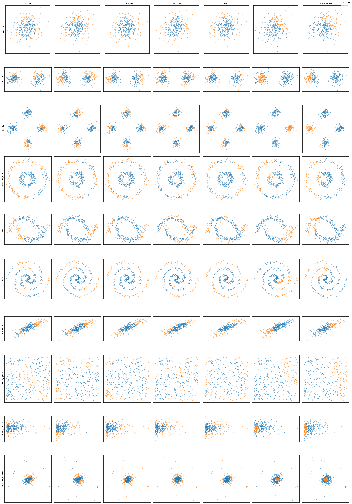
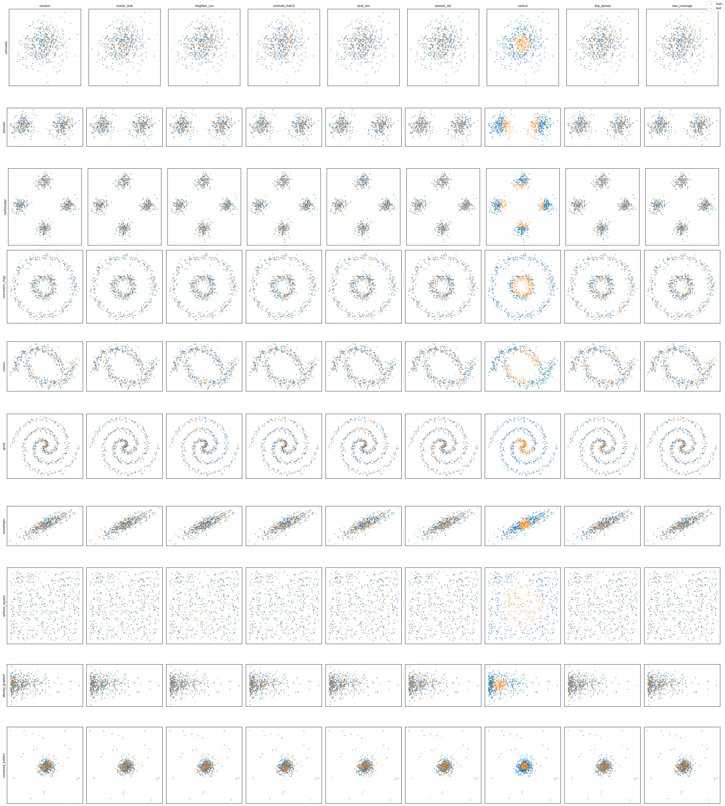
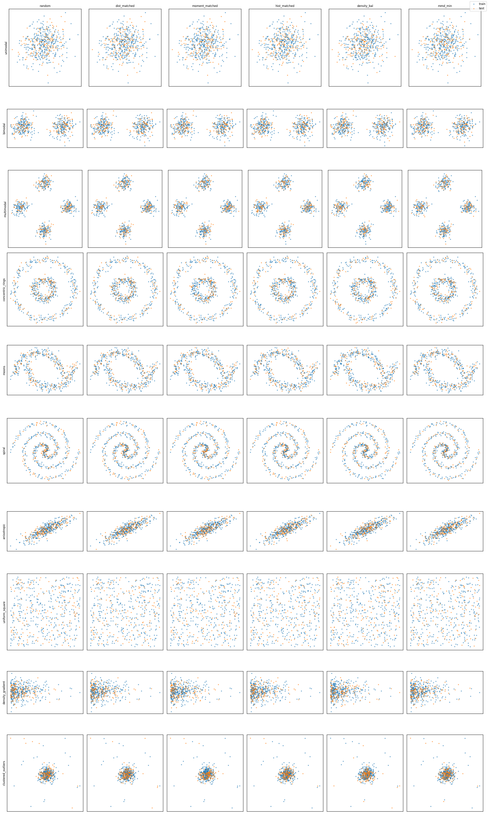
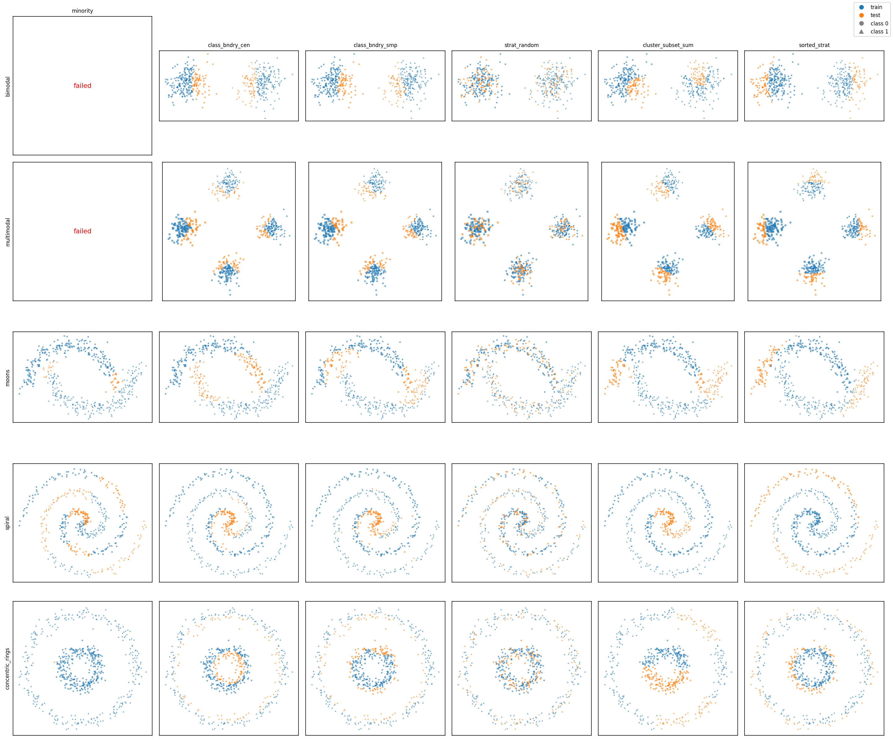

# splytters

[](https://pypi.org/project/splytters/)
[](https://github.com/gxlarson/splytters/actions/workflows/ci.yml)
[](https://codecov.io/gh/gxlarson/splytters)
[](https://splytters.readthedocs.io/en/latest/)
[](https://github.com/gxlarson/splytters/blob/main/LICENSE)
[](https://pypi.org/project/splytters/)
[](https://github.com/astral-sh/ruff)

**Embedding-based data splits for model robustness testing.**

A random split measures how a model performs on test data that is drawn from the
same distribution as its training data. `splytters` controls how similar the
training and test splits are in embedding space, with splitters for three
objectives:

| Objective | Module | What it does | Use it for |
|---|---|---|---|
| **Adversarial** | `splytters.adversarial` | Minimizes the similarity between the training and test splits | Hard evaluation: generalization to unfamiliar data |
| **Overlap** | `splytters.overlap` | Maximizes the similarity between the training and test splits | Easy evaluation: debugging and estimates of an upper bound |
| **Balanced** | `splytters.balanced` | Matches the distributions of the training and test splits | Fair evaluation without accidental distribution shift |

Every splitter takes an embedding matrix of shape `(n_samples, dim)` (a NumPy
array, a list, a pandas object or a torch tensor) and returns arrays of integer
indices, so it works with any data that you can embed: text, images, audio or
tabular rows.

## Installation

```bash
pip install splytters
```

The core install depends only on NumPy, SciPy and scikit-learn, and it includes
every splitter. Optional extras add the dependencies for the sorters, the
built-in embedders and the demos:

```bash
pip install "splytters[text]"       # text sorters (torch, transformers, py-readability-metrics, wordfreq, pysbd)
pip install "splytters[image]"      # image sorters (Pillow)
pip install "splytters[audio]"      # audio sorters (librosa, soundfile)
pip install "splytters[tabular]"    # tabular sorters (pandas)
pip install "splytters[embedders]"  # built-in embedders (sentence-transformers, torch, transformers, openai)
pip install "splytters[ann]"        # approximate nearest neighbors for large datasets (pynndescent)
pip install "splytters[demo]"       # demo scripts (sentence-transformers, datasets, matplotlib, umap-learn)
pip install "splytters[all]"        # all of the above, plus matplotlib
```

The sorters import their optional dependencies separately for each modality.
`import splytters.sorters` does not import any of them, and each extra is
sufficient for its own modality: `[image]` alone is enough for the image sorters.

`splytters` requires Python 3.10 or later and is tested on Python 3.10 to 3.14.

To install from source:

```bash
git clone https://github.com/gxlarson/splytters
cd splytters
pip install -e ".[all]"
```

## Quickstart

```python
import numpy as np
from splytters import cluster_split

embeddings = np.random.rand(500, 384)  # your embeddings here

train_idx, test_idx = cluster_split(embeddings, train_size=0.7)
```

Every splitter has the same interface, in the style of scikit-learn:

```python
train_indices, test_indices = some_split(
    embeddings,        # (n_samples, embedding_dim) array-like
    train_size=0.7,    # fraction in (0, 1) OR an absolute count
    random_state=42,
)
```

An example with text embeddings:

```python
from sentence_transformers import SentenceTransformer
from splytters import centroid_adversarial_split

texts = [...]  # your dataset
embeddings = SentenceTransformer("all-MiniLM-L6-v2").encode(texts)

train_idx, test_idx = centroid_adversarial_split(embeddings, train_size=0.7)
train = [texts[i] for i in train_idx]
test = [texts[i] for i in test_idx]
```

## Integrations

A splitter can be used in scikit-learn as a cross-validator or in place of
`train_test_split`:

```python
from sklearn.linear_model import LogisticRegression
from sklearn.model_selection import cross_validate
from splytters import SplytterSplit, adversarial_train_test_split, cluster_split

# 1) as a CV object (single hard split) in cross_validate / GridSearchCV
cv = SplytterSplit(cluster_split, embeddings=X, n_clusters=10)
cross_validate(LogisticRegression(), X, y, cv=cv)

# 2) in place of train_test_split (splits every array the same way)
X_tr, X_te, y_tr, y_te = adversarial_train_test_split(X, y, embeddings=X)
```

Three helpers split pandas, PyTorch and Hugging Face datasets. Each one imports
its library only when it is called:

```python
from splytters import split_dataframe, to_torch_subsets, split_dataset

train_df, test_df   = split_dataframe(df, embeddings)              # pandas
train_ds, test_ds   = to_torch_subsets(torch_dataset, embeddings)  # PyTorch
dsdict              = split_dataset(hf_dataset, embeddings)        # → DatasetDict
```

## Split reports

```python
from splytters import split_report, compare_splitters, random_split, cluster_split

compare_splitters(embeddings, {"random": random_split, "adversarial": cluster_split})
# {'random': {...}, 'adversarial': {'mmd_rbf': ..., 'energy_distance': ...,
#                                   'wasserstein_mean': ..., 'coverage': ..., ...}}
```

`split_report` measures how different the training and test splits are. It
reports the distance between the centroids of the two splits, the distance from
each test sample to its nearest training sample, coverage, cluster leakage,
MMD, energy distance, the mean one-dimensional Wasserstein distance and KS
statistic, and, when labels are given, the shift in the label distribution.
`compare_splitters` computes the same report for several splitters.

## Available splitters

**Adversarial** (minimize the similarity between the training and test splits):
`cluster_split`, `centroid_adversarial_split`, `distance_adversarial_split`, `density_adversarial_split`, `outlier_adversarial_split`, `min_cut_split`, `normalized_cut_split`, `wasserstein_adversarial_split`, `mmd_maximized_split`, `minority_split`, `minority_grow_split`, `class_boundary_split`, `decision_boundary_split`, `maximin_split`



**Overlap** (maximize the similarity between the training and test splits):
`cluster_leak_split`, `neighbor_coverage_split`, `centroid_matched_split`, `stratified_similarity_split`, `nearest_neighbor_split`, `central_split`, `duplicate_spread_split`, `max_coverage_split`



**Balanced** (match the distributions of the training and test splits):
`distribution_matched_split`, `moment_matched_split`, `histogram_matched_split`, `stratified_random_split`, `density_balanced_split`, `mmd_minimized_split`



**Grouped** (assign related samples or near-duplicates to the same split, so
that they cannot leak from training to test): `group_split` (explicit group
ids), `deduplicated_split` (near-duplicates found from the embeddings)

**Supervised** (these take class labels `y`):
`class_boundary_split`, `decision_boundary_split`, `minority_split`, `minority_grow_split`, `stratified_random_split`, `sorted_stratified_split`, `cluster_split(strategy="subset_sum")`



`splytters` also exports a `random_split` baseline and utilities such as
`compute_pairwise_distances`, `compute_split_similarity` and
`cluster_embeddings`.

In each figure, each row is a 2D distribution (unimodal, moons, spirals, rings
and others), and each column is a splitter. Blue points are in the training
split and orange points are in the test split. In the supervised figure, the
shape of each marker shows its class, and the blob distributions have
overlapping classes, so that the label-aware splitters have a boundary between
classes to work with. `demos/visualize_splits.py` generates the unsupervised
figures, and `demos/visualize_supervised_splits.py` generates the supervised
one.

## Sorters

The `splytters.sorters` package ranks samples by interpretable measures of
difficulty or quality. The rankings can be used to inspect a dataset or to make
curriculum splits, for example with the easy samples in training and the hard
samples in test.

- **`embedding_sorters`**: `distance_to_mean`, `mahalanobis_distance_to_mean`, `distance_to_nearest_neighbor`, `local_density`, `outlier_score`, `knn_label_disagreement` (label-aware)
- **`text_sorters`**: length, readability, perplexity, lexical diversity, vocabulary rarity, sentence count and gzip complexity
- **`image_sorters`**: brightness, contrast, color variance, compression ratio, frequency content and sharpness
- **`audio_sorters`**: loudness, spectral features, MFCCs, rhythm and quality metrics
- **`tabular_sorters`**: column-level and row-level metrics, categorical columns and sorting by several columns

```python
from splytters.sorters import distance_to_mean

ranked = distance_to_mean(embeddings)  # most typical → most atypical
```

`sorted_stratified_split` turns a ranking into a curriculum split. Within each
class, it assigns the first `train_size` fraction of the ranking to the
training split and the rest to the test split:

```python
from splytters.sorters import vocabulary_rarity
from splytters import sorted_stratified_split

ranking = vocabulary_rarity(texts)                 # common words → rare words
train_idx, test_idx = sorted_stratified_split(ranking, y, train_size=0.7)
# largest_first=True reverses the ranking: train on hard, test on easy
```

`demos/demo.py` applies the sorters to the TREC question dataset, and
`demos/im_demo.py` applies them to images with CLIP embeddings.
`demos/trec_sorter_experiment.py` trains a linear SVM on curriculum splits of
TREC to measure which text sorters rank the questions by difficulty.

## Documentation

The [documentation](https://splytters.readthedocs.io) contains a guide and the
API reference.

## Tests

```bash
pip install -e ".[dev]"
pytest
```

## Contributing

[CONTRIBUTING.md](CONTRIBUTING.md) describes the development setup, the
conventions and the pre-commit hooks (gitleaks secret scanning and ruff) to
install before your first commit.

## Project layout

```
splytters/                # the installable package
  adversarial.py / overlap.py / balanced.py   # embedding splitters by family
  grouped.py              # group_split, deduplicated_split (keep related samples together)
  stratify.py             # per_class_split / per_class_sort wrappers
  likelihood.py           # likelihood_split (Godbole & Jia 2023)
  curriculum.py           # sorted_stratified_split (easy -> train, hard -> test along a sort order)
  utils.py                # shared helpers (validation, neighbors, clustering)
  metrics.py              # diversity metrics for comparing splits
  distances.py            # text similarity (difflib, n-gram Jaccard)
  sklearn_api.py          # SplytterSplit + *_train_test_split
  interop.py              # pandas / torch / HuggingFace adapters
  report.py               # split_report, compare_splitters
  embedders.py            # text / image embedders (TextEmbedder, CLIP, OpenAI)
  sorters/                # ranking metrics (text, image, audio, embedding, tabular)
tests/                    # pytest suite
test_data/                # sample audio/images/text used by tests
demos/                    # demo.py, im_demo.py (sorter demos: TREC text, CLIP images)
                          # visualize_splits.py + visualize_supervised_splits.py (README figures), visualize_text_splits.py
scripts/                  # generate_test_*.py (regenerate the test_data/ fixtures)
docs/                     # MkDocs site source (guides, API reference) + README figures
```
