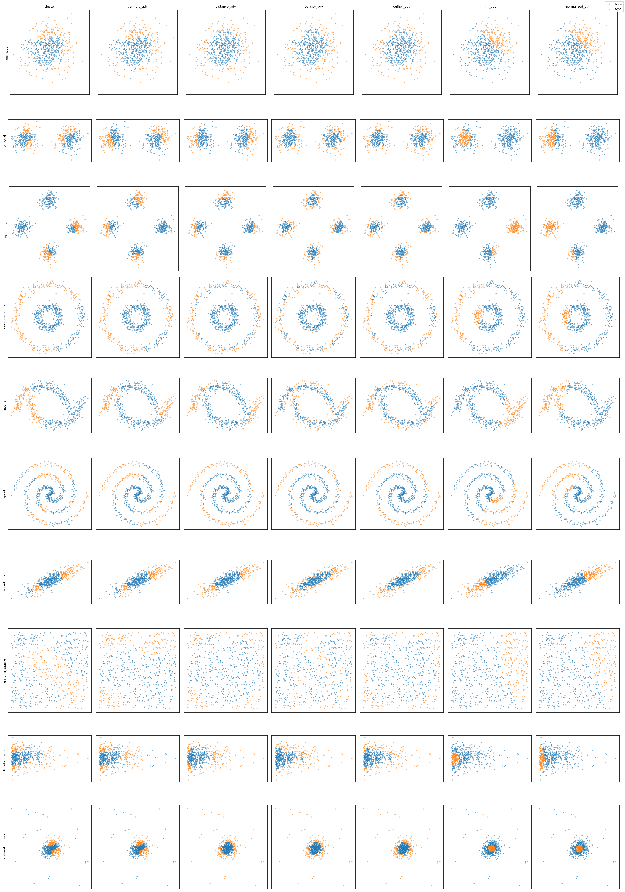
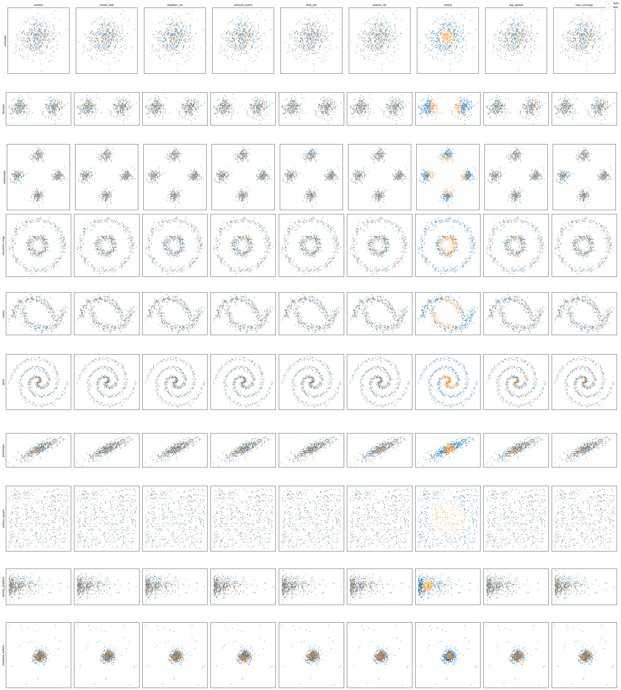
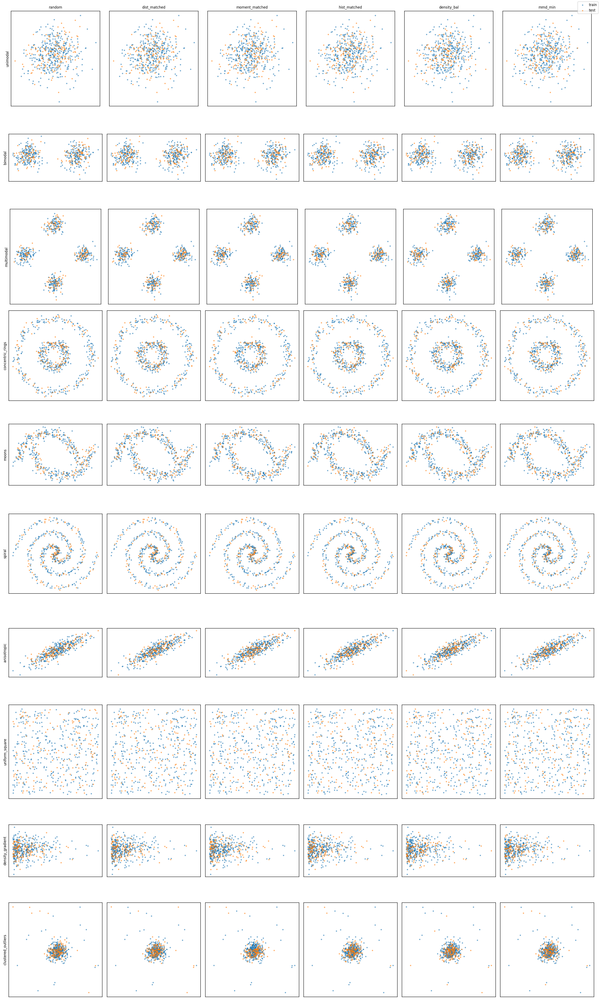

# splytters

**Clustering-based data splits for model robustness testing.** `splytters`
provides adversarial, overlap, and distribution-balanced train-test splits, with
an API aligned with scikit-learn.

Standard random splits assume that the training and test data are drawn from
the same distribution. `splytters` controls how similar the training and test
splits are in embedding space. Adversarial splits make evaluation harder,
overlap splits make it easier (for sanity checks), and distribution-balanced
splits make it fair, so that you can measure how a model behaves under
covariate shift.

## Install

```bash
pip install splytters
```

The core install depends only on `numpy`, `scipy`, and `scikit-learn`. Optional
extras add modality sorters and embedders, which the [Guide](guide.md)
describes.

## Quickstart

```python
import numpy as np
from splytters import cluster_split, split_report

# Any (n_samples, n_features) embedding matrix.
X = np.random.default_rng(0).normal(size=(500, 16))

# An adversarial split: each cluster goes entirely to train or to test.
train_idx, test_idx = cluster_split(X, train_size=0.7)

# Measure how different the two splits are (centroid distance, coverage,
# leakage, MMD, energy distance, Wasserstein, KS).
report = split_report(X, train_idx, test_idx)
print(report)
```

The family wrappers can replace `sklearn.model_selection.train_test_split`:

```python
from splytters import adversarial_train_test_split

X_train, X_test, y_train, y_test = adversarial_train_test_split(
    X, y, train_size=0.7
)
```

`SplytterSplit` can be used as a cross-validator wherever scikit-learn accepts
`cv=`:

```python
from sklearn.linear_model import LogisticRegression
from sklearn.model_selection import cross_validate
from splytters import SplytterSplit

cv = SplytterSplit(embeddings=X, n_splits=5)
scores = cross_validate(LogisticRegression(), X, y, cv=cv)
```

## The three split families

| Family | Goal | Use it to |
| --- | --- | --- |
| **Adversarial** | *minimize* train↔test similarity | stress-test under covariate shift |
| **Overlap** | *maximize* train↔test similarity | sanity-check / establish an upper bound |
| **Balanced** | *match* train↔test distributions | fair, like-for-like evaluation |

<div class="grid" markdown>



</div>

Each row is a 2D distribution (unimodal, moons, spirals, rings and others), and
each column is a splitter. Blue points are in the training split and orange
points are in the test split.

The [Guide](guide.md) describes the splitters in more detail, and the
[API reference](api.md) lists every function and its parameters.
