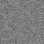
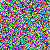
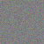
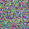

# Sorter gallery

This page applies every sorter in `splytters.sorters` to a small example, so that you can see what each one ranks first and last. All sorters rank from the lowest to the highest score by default (`low_first=True`), and `sorted_stratified_split` assigns the first `train_size` fraction of each class to train, so by default the highest-scoring samples go to test.

This page is generated by `docs/examples/sorter_gallery.py`.

## Text sorters

The 10 example queries all ask for an account balance:

| ID | Query |
|---|---|
| Q1 | what is my balance |
| Q2 | my bank balance is what |
| Q3 | balance |
| Q4 | what's my balance |
| Q5 | tell me my balance please |
| Q6 | can you check how much money is in my checking account right now |
| Q7 | what is the current balance of my savings account at the bank |
| Q8 | show me my balance and then show me my balance history |
| Q9 | how much cash do i have |
| Q10 | how full are my coffers today |

Each row lists the queries from the lowest to the highest score (in parentheses).

| Sorter | Order, lowest score first |
|---|---|
| `character_length` | Q3 (7) → Q4 (17) → Q1 (18) → Q2 (23) → Q9 (23) → Q5 (25) → Q10 (29) → Q8 (54) → Q7 (61) → Q6 (64) |
| `gzip_complexity` | Q8 (1.07) → Q6 (1.14) → Q7 (1.21) → Q10 (1.69) → Q2 (1.78) → Q5 (1.8) → Q9 (1.87) → Q1 (2.11) → Q4 (2.18) → Q3 (3.86) |
| `lexical_diversity` | Q8 (0.636) → Q7 (0.917) → Q1 (1) → Q2 (1) → Q3 (1) → Q4 (1) → Q5 (1) → Q6 (1) → Q9 (1) → Q10 (1) |
| `perplexity_score` | Q6 (23.4) → Q7 (38.5) → Q8 (109) → Q9 (115) → Q1 (269) → Q2 (296) → Q4 (403) → Q10 (1.31e+03) → Q5 (1.38e+03) → Q3 (inf) |
| `readability_score` | Q1 (inf) → Q2 (inf) → Q3 (inf) → Q4 (inf) → Q5 (inf) → Q6 (inf) → Q7 (inf) → Q8 (inf) → Q9 (inf) → Q10 (inf) |
| `sentence_count` | Q1 (1) → Q2 (1) → Q3 (1) → Q4 (1) → Q5 (1) → Q6 (1) → Q7 (1) → Q8 (1) → Q9 (1) → Q10 (1) |
| `tokens_length` | Q3 (1) → Q4 (3) → Q1 (4) → Q2 (5) → Q5 (5) → Q9 (6) → Q10 (6) → Q8 (11) → Q7 (12) → Q6 (13) |
| `vocabulary_rarity` | Q7 (0.987) → Q1 (0.996) → Q6 (0.996) → Q8 (0.996) → Q9 (0.996) → Q2 (0.996) → Q10 (0.998) → Q5 (0.998) → Q4 (0.999) → Q3 (1) |

`readability_score` requires at least 100 words per text, so every query scores `inf` and keeps its input order. Use it on paragraphs or documents.

## Embedding sorters

The same 10 queries, embedded with `TextEmbedder("all-MiniLM-L6-v2")`.

| Sorter | Order, lowest score first |
|---|---|
| `distance_to_mean` | Q4 (0.482) → Q1 (0.509) → Q2 (0.528) → Q5 (0.534) → Q3 (0.618) → Q8 (0.653) → Q7 (0.701) → Q6 (0.804) → Q9 (0.836) → Q10 (0.878) |
| `distance_to_nearest_neighbor` | Q1 (0.271) → Q4 (0.271) → Q5 (0.497) → Q3 (0.533) → Q2 (0.694) → Q7 (0.694) → Q8 (0.784) → Q6 (0.9) → Q9 (0.992) → Q10 (1.09) |
| `local_density` | Q10 (0) → Q9 (1) → Q6 (3) → Q3 (5) → Q7 (5) → Q1 (6) → Q4 (6) → Q5 (6) → Q8 (6) → Q2 (8) |
| `mahalanobis_distance_to_mean` | Q4 (2.85) → Q1 (2.85) → Q5 (2.85) → Q2 (2.85) → Q3 (2.85) → Q8 (2.85) → Q7 (2.85) → Q6 (2.85) → Q9 (2.85) → Q10 (2.85) |
| `outlier_score` | Q4 (0.435) → Q1 (0.439) → Q5 (0.461) → Q2 (0.463) → Q3 (0.465) → Q7 (0.487) → Q8 (0.511) → Q10 (0.514) → Q6 (0.517) → Q9 (0.522) |

`knn_label_disagreement` is not shown here because it also requires class labels. It ranks each sample by the fraction of its nearest neighbors that have a different label. `mahalanobis_distance_to_mean` requires more samples than embedding dimensions. With 10 samples in 384 dimensions, the covariance matrix is singular, so the sorter assigns the same distance to every query.

## Image sorters

Ten synthetic test images from `test_data/images/`, named for the property that each one illustrates:

| brightness_dark | brightness_bright | color_grayscale | color_vibrant | compress_simple | compress_complex | contrast_low | contrast_high | freq_smooth | freq_detailed |
|---|---|---|---|---|---|---|---|---|---|
|  |  |  |  |  |  |  |  |  |  |

Each row shows the images from the lowest to the highest score (hover for the file name).

| Sorter | Order, lowest score first |
|---|---|
| `color_variance` |           |
| `contrast` |           |
| `dominant_color` |           |
| `frequency_content` |           |
| `image_compression_ratio` |           |
| `mean_brightness` |           |
| `sharpness` |           |

## Audio sorters

Ten synthetic clips from `test_data/audio/`, named for the property that each one illustrates.

| Sorter | Order, lowest score first |
|---|---|
| `audio_compression_ratio` | `flatness_noisy` (8.95) → `loudness_loud` (18.6) → `spectral_bright` (18.6) → `flatness_tonal` (18.6) → `loudness_quiet` (18.7) → `pitch_low` (18.8) → `spectral_dark` (18.8) → `pitch_high` (19.3) → `tempo_fast` (33.1) → `tempo_slow` (43.1) |
| `beat_strength` | `spectral_bright` (0.001) → `pitch_high` (0.00123) → `loudness_loud` (0.00158) → `flatness_tonal` (0.00158) → `loudness_quiet` (0.002) → `pitch_low` (0.013) → `spectral_dark` (0.013) → `tempo_slow` (0.695) → `flatness_noisy` (0.861) → `tempo_fast` (4.02) |
| `duration` | `loudness_quiet` (1) → `loudness_loud` (1) → `pitch_low` (1) → `pitch_high` (1) → `spectral_dark` (1) → `spectral_bright` (1) → `flatness_tonal` (1) → `flatness_noisy` (1) → `tempo_slow` (2) → `tempo_fast` (2) |
| `dynamic_range` | `spectral_bright` (4.59e-05) → `loudness_quiet` (0.000204) → `pitch_high` (0.00084) → `loudness_loud` (0.00204) → `flatness_tonal` (0.00204) → `pitch_low` (0.0118) → `spectral_dark` (0.0118) → `flatness_noisy` (0.0118) → `tempo_slow` (0.0486) → `tempo_fast` (0.0486) |
| `fundamental_frequency` | `tempo_slow` (0) → `tempo_fast` (0) → `flatness_noisy` (0) → `pitch_low` (100) → `spectral_dark` (100) → `loudness_quiet` (440) → `loudness_loud` (440) → `flatness_tonal` (440) → `pitch_high` (999) → `spectral_bright` (2.01e+03) |
| `harmonic_ratio` | `tempo_slow` (0) → `tempo_fast` (0) → `flatness_noisy` (1) → `pitch_high` (455) → `loudness_quiet` (469) → `loudness_loud` (469) → `flatness_tonal` (469) → `pitch_low` (490) → `spectral_dark` (490) → `spectral_bright` (597) |
| `mean_amplitude` | `tempo_slow` (0.000564) → `tempo_fast` (0.00197) → `loudness_quiet` (0.0637) → `flatness_noisy` (0.175) → `pitch_low` (0.637) → `pitch_high` (0.637) → `spectral_dark` (0.637) → `spectral_bright` (0.637) → `loudness_loud` (0.637) → `flatness_tonal` (0.637) |
| `mfcc_mean` | `tempo_slow` (-758) → `tempo_fast` (-633) → `loudness_quiet` (-621) → `spectral_bright` (-458) → `pitch_low` (-404) → `spectral_dark` (-404) → `pitch_high` (-396) → `loudness_loud` (-394) → `flatness_tonal` (-394) → `flatness_noisy` (53) |
| `mfcc_variance` | `flatness_noisy` (12.2) → `pitch_low` (191) → `spectral_dark` (191) → `loudness_loud` (477) → `flatness_tonal` (477) → `loudness_quiet` (477) → `pitch_high` (659) → `spectral_bright` (768) → `tempo_slow` (1.86e+03) → `tempo_fast` (5.95e+03) |
| `peak_to_average_ratio` | `loudness_loud` (1.57) → `flatness_tonal` (1.57) → `spectral_bright` (1.57) → `pitch_low` (1.57) → `pitch_high` (1.57) → `spectral_dark` (1.57) → `loudness_quiet` (1.57) → `flatness_noisy` (5.64) → `tempo_fast` (395) → `tempo_slow` (1.38e+03) |
| `rms_energy` | `tempo_slow` (0.0148) → `tempo_fast` (0.0277) → `loudness_quiet` (0.0707) → `flatness_noisy` (0.22) → `pitch_low` (0.707) → `pitch_high` (0.707) → `spectral_dark` (0.707) → `spectral_bright` (0.707) → `loudness_loud` (0.707) → `flatness_tonal` (0.707) |
| `spectral_bandwidth` | `pitch_low` (111) → `spectral_dark` (111) → `tempo_slow` (129) → `loudness_loud` (152) → `flatness_tonal` (152) → `pitch_high` (155) → `spectral_bright` (168) → `loudness_quiet` (314) → `tempo_fast` (536) → `flatness_noisy` (3.19e+03) |
| `spectral_centroid` | `pitch_low` (106) → `spectral_dark` (106) → `tempo_slow` (124) → `loudness_loud` (453) → `flatness_tonal` (453) → `loudness_quiet` (461) → `tempo_fast` (499) → `pitch_high` (1.02e+03) → `spectral_bright` (4.01e+03) → `flatness_noisy` (5.5e+03) |
| `spectral_flatness` | `pitch_low` (2.07e-07) → `spectral_dark` (2.07e-07) → `loudness_loud` (3.99e-06) → `flatness_tonal` (3.99e-06) → `loudness_quiet` (3.99e-06) → `pitch_high` (2.01e-05) → `spectral_bright` (0.00021) → `flatness_noisy` (0.561) → `tempo_fast` (0.702) → `tempo_slow` (0.921) |
| `spectral_rolloff` | `pitch_low` (111) → `spectral_dark` (111) → `tempo_slow` (174) → `loudness_quiet` (460) → `loudness_loud` (460) → `flatness_tonal` (460) → `tempo_fast` (733) → `pitch_high` (1.03e+03) → `spectral_bright` (4.04e+03) → `flatness_noisy` (9.37e+03) |
| `tempo` | `loudness_quiet` (0) → `loudness_loud` (0) → `pitch_low` (0) → `pitch_high` (0) → `spectral_dark` (0) → `spectral_bright` (0) → `flatness_tonal` (0) → `flatness_noisy` (92.3) → `tempo_slow` (117) → `tempo_fast` (185) |
| `zero_crossing_rate` | `tempo_slow` (0.000393) → `tempo_fast` (0.00146) → `pitch_low` (0.00874) → `spectral_dark` (0.00874) → `loudness_quiet` (0.0385) → `loudness_loud` (0.0385) → `flatness_tonal` (0.0385) → `pitch_high` (0.0876) → `spectral_bright` (0.351) → `flatness_noisy` (0.481) |

## Tabular sorters

A 10-row table with an outlier (R10), two missing values (R7) and a rare city (R9):

| | age | income | city | plan | visits |
|---|---|---|---|---|---|
| R1 | 34 | 52000.0 | Boston | basic | 3 |
| R2 | 29 | 48000.0 | Boston | basic | 5 |
| R3 | 41 | 61000.0 | Denver | pro | 0 |
| R4 | 38 | 0.0 | Boston | basic | 4 |
| R5 | 25 | 45000.0 | Denver | basic | 6 |
| R6 | 52 | 75000.0 | Boston | pro | 2 |
| R7 | 31 |  | Denver |  | 0 |
| R8 | 47 | 66000.0 | Boston | pro | 3 |
| R9 | 36 | 58000.0 | Boise | basic | 4 |
| R10 | 90 | 950000.0 | Boston | pro | 1 |

Sorters that rank by one column use `income` (numeric) or `city` (categorical).

| Sorter | Order, lowest score first |
|---|---|
| `categorical_rarity` | R1 (0.6) → R2 (0.6) → R4 (0.6) → R6 (0.6) → R8 (0.6) → R10 (0.6) → R3 (0.3) → R5 (0.3) → R7 (0.3) → R9 (0.1) |
| `column_absolute_zscore` | R6 (0.251) → R8 (0.281) → R3 (0.298) → R9 (0.308) → R1 (0.328) → R2 (0.341) → R5 (0.351) → R4 (0.501) → R10 (2.66) → R7 (inf) |
| `column_rank` | R4 (11.1) → R5 (22.2) → R2 (33.3) → R1 (44.4) → R9 (55.6) → R3 (66.7) → R8 (77.8) → R6 (88.9) → R10 (100) → R7 (inf) |
| `column_value` | R4 (0) → R5 (4.5e+04) → R2 (4.8e+04) → R1 (5.2e+04) → R9 (5.8e+04) → R3 (6.1e+04) → R8 (6.6e+04) → R6 (7.5e+04) → R10 (9.5e+05) → R7 (nan) |
| `column_zscore` | R4 (-0.501) → R5 (-0.351) → R2 (-0.341) → R1 (-0.328) → R9 (-0.308) → R3 (-0.298) → R8 (-0.281) → R6 (-0.251) → R10 (2.66) → R7 (inf) |
| `feature_entropy` | R1 (1.1) → R2 (1.1) → R4 (1.1) → R6 (1.32) → R8 (1.32) → R10 (1.32) → R5 (1.79) → R3 (2.01) → R9 (2.89) → R7 (23.5) |
| `missing_value_ratio` | R1 (0) → R2 (0) → R3 (0) → R4 (0) → R5 (0) → R6 (0) → R8 (0) → R9 (0) → R10 (0) → R7 (0.4) |
| `multi_column_sort` | R3 (0.0642) → R6 (0.412) → R7 (0.5) → R1 (0.555) → R8 (0.569) → R4 (0.667) → R9 (0.728) → R2 (0.884) → R5 (1.05) → R10 (1.17) |
| `numerical_range_score` | R1 (6.85) → R9 (10.2) → R8 (20.9) → R3 (23.9) → R4 (24.6) → R7 (27.5) → R2 (28.9) → R6 (29.6) → R5 (39.3) → R10 (40) |
| `row_sparsity` | R1 (0) → R2 (0) → R5 (0) → R6 (0) → R8 (0) → R9 (0) → R10 (0) → R3 (0.333) → R4 (0.333) → R7 (0.333) |
| `tabular_distance_to_mean` | R6 (6.63e+04) → R8 (7.53e+04) → R3 (8.03e+04) → R9 (8.33e+04) → R7 (8.33e+04) → R1 (8.93e+04) → R2 (9.33e+04) → R5 (9.63e+04) → R4 (1.41e+05) → R10 (8.09e+05) |
| `tabular_outlier_score` | R9 (0.384) → R1 (0.388) → R8 (0.424) → R2 (0.433) → R7 (0.448) → R3 (0.462) → R6 (0.479) → R4 (0.48) → R5 (0.521) → R10 (0.729) |
